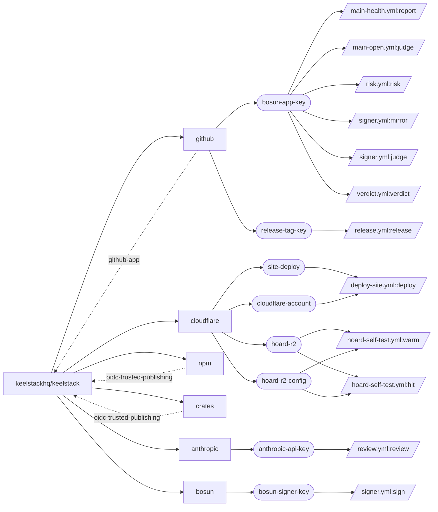

# System: keelstackhq/keelstack

<!-- Generated by `hoist system explain --write` from system.toml; do not edit. -->

Owner: urbanisierung

The keelstack monorepo: CI on GitHub Actions, gates by the bosun gate App, the site on Cloudflare Pages, the hoard cache self-test on R2, releases to crates.io and npm by trusted publishing.

## github

| capability | account | console | docs | CLIs | alternatives |
| --- | --- | --- | --- | --- | --- |
| vcs+ci | keelstackhq | https://github.com/keelstackhq/keelstack/settings/environments | https://docs.github.com/en/actions/security-for-github-actions/security-guides/using-secrets-in-github-actions | gh (mise `gh`), hoist (mise `npm:@keelstackhq/hoist`) | gitlab, forgejo |

| credential | kind | role | purpose | storage | consumers | created | expires | rotate | status |
| --- | --- | --- | --- | --- | --- | --- | --- | --- | --- |
| bosun-app-key | app_key | checks | Private key of the GitHub App keelstackhq-bosun-gate: mints installation tokens that post risk-check, review-verdict, main-open and bosun-ci-ok | `gh-env:bosun-app/BOSUN_APP_KEY` | main-health.yml:report, main-open.yml:judge, risk.yml:risk, signer.yml:mirror, signer.yml:judge, verdict.yml:verdict | — | never | — | active |
| release-tag-key | ssh_key | push-tags | Write deploy key, the only bypass actor of ruleset `hoist: tags`: release.yml pushes vX.Y.Z and v0 over SSH with it | `gh-env:release-tags/RELEASE_TAG_KEY` | release.yml:release | — | never | — | active |

## cloudflare

| capability | account | console | docs | CLIs | alternatives |
| --- | --- | --- | --- | --- | --- |
| dns+cdn | keelstackhq | https://dash.cloudflare.com/profile/api-tokens | https://developers.cloudflare.com/fundamentals/api/get-started/create-token/ | wrangler (mise `npm:wrangler`) | bunny, netlify |

| credential | kind | role | purpose | storage | consumers | created | expires | rotate | status |
| --- | --- | --- | --- | --- | --- | --- | --- | --- | --- |
| site-deploy | api_token | deploy | Deploy site/apps/site/dist to Cloudflare Pages project keelstack-landing (deploy-site.yml) | `gh-env:site/CLOUDFLARE_API_TOKEN` | deploy-site.yml:deploy | — | — | — | active |
| cloudflare-account | other | config | Cloudflare account id for wrangler pages deploy (not a credential, kept beside the token) | `gh-env:site/CLOUDFLARE_ACCOUNT_ID` | deploy-site.yml:deploy | — | never | — | active |
| hoard-r2 | api_token | cache-rw | S3 key pair for the hoard self-test's R2 bucket (warm writes, hit reads) | `gh-env:hoard-r2/R2_ACCESS_KEY_ID`, `gh-env:hoard-r2/R2_SECRET_ACCESS_KEY` | hoard-self-test.yml:warm, hoard-self-test.yml:hit | — | — | — | active |
| hoard-r2-config | other | config | R2 account id and bucket name of the hoard self-test (not credentials, kept beside the key pair) | `gh-env:hoard-r2/R2_ACCOUNT_ID`, `gh-env:hoard-r2/R2_BUCKET` | hoard-self-test.yml:warm, hoard-self-test.yml:hit | — | never | — | active |

## npm

| capability | account | console | docs | CLIs | alternatives |
| --- | --- | --- | --- | --- | --- |
| registry.npm | keelstackhq | https://www.npmjs.com/settings/keelstackhq/packages | https://docs.npmjs.com/trusted-publishers | npm (mise `node`) | jsr |

## crates

| capability | account | console | docs | CLIs | alternatives |
| --- | --- | --- | --- | --- | --- |
| registry.crates | urbanisierung | https://crates.io/settings/tokens | https://crates.io/docs/trusted-publishing | cargo (mise `rust`) | — |

## anthropic

| capability | account | console | docs | CLIs | alternatives |
| --- | --- | --- | --- | --- | --- |
| llm.api | keelstackhq | https://console.anthropic.com/settings/keys | https://docs.anthropic.com/en/api/getting-started | — | — |

| credential | kind | role | purpose | storage | consumers | created | expires | rotate | status |
| --- | --- | --- | --- | --- | --- | --- | --- | --- | --- |
| anthropic-api-key | api_token | review | CI review (review.yml) when variable BOSUN_REVIEW_CI is true; optional ([github] optional_secrets) | `gh-env:review/ANTHROPIC_API_KEY` | review.yml:review | — | — | — | active |

## bosun

| capability | account | console | docs | CLIs | alternatives |
| --- | --- | --- | --- | --- | --- |
| signing | keelstackhq/keelstack .bosun/approvers.toml | — | bosun/docs/spec/08-risk.md | bosun (mise `npm:@keelstackhq/bosun`) | — |

| credential | kind | role | purpose | storage | consumers | created | expires | rotate | status |
| --- | --- | --- | --- | --- | --- | --- | --- | --- | --- |
| bosun-signer-key | other | sign | The CI signer's bosun key (role signer, id signer-ci): signs the autonomous approval of a PR when the quorum allows it | `gh-env:bosun-signer/BOSUN_SIGNER_KEY` | signer.yml:sign | — | never | — | active |

## Keyless trust

| provider | kind | subject | replaces |
| --- | --- | --- | --- |
| npm | oidc-trusted-publishing | keelstackhq/keelstack release.yml and cargo-deny-npm.yml, environment release | publish |
| crates | oidc-trusted-publishing | keelstackhq/keelstack release.yml, environment release | publish |
| github | github-app | keelstackhq-bosun-gate | pat |

## Rotation

### bosun-app-key

- Principal: GitHub App keelstackhq-bosun-gate (client id: variable BOSUN_APP_CLIENT_ID)
- Resources: repo:keelstackhq/keelstack
- Created via: `GitHub > Settings > Developer settings > GitHub Apps > keelstackhq-bosun-gate > Generate a private key; then `hoist secrets set BOSUN_APP_KEY --from-file key.pem``
- Strategy: assisted
- Command: `hoist secrets set BOSUN_APP_KEY --from-file key.pem`
1. Generate a new private key on the App settings page
2. Run the command with the new PEM, then delete the PEM
3. Re-run a gated PR's checks
4. Delete the old key on the App settings page

### bosun-signer-key

- Principal: approver signer-ci in .bosun/approvers.toml
- Created via: `bosun keygen --role signer --id signer-ci --out <pem outside the repo> --enroll; then `hoist secrets set BOSUN_SIGNER_KEY --from-file <pem>``
- Strategy: manual
1. bosun keygen --role signer --id signer-ci --out <pem outside the repo> --enroll
2. Merge the .bosun/approvers.toml PR (owner-approved, R-gov)
3. hoist secrets set BOSUN_SIGNER_KEY --from-file <pem>, then delete the PEM
4. Remove the old public key from .bosun/approvers.toml

### release-tag-key

- Principal: deploy key `hoist: release tags`
- Scopes: deploy key: write
- Resources: tags v*
- Created via: `hoist apply`
- Strategy: assisted
- Command: `hoist apply`
1. Delete deploy key `hoist: release tags` and secret RELEASE_TAG_KEY of environment release-tags
2. Run `hoist apply` (or `keel up`): it mints a new ed25519 key, adds it and seals the private half

### site-deploy

- Principal: hoist-minted token (name prefix `hoist:`)
- Scopes: Pages Write
- Resources: pages:keelstack-landing
- Created via: `hoist apply (mints the token for one year and seals it)`
- Max TTL: 1y
- Strategy: auto
- Command: `hoist secrets rotate CLOUDFLARE_API_TOKEN`

### cloudflare-account

- Strategy: not described (add `rotation` to system.toml)

### hoard-r2

- Principal: R2 API token
- Scopes: Workers R2 Storage Bucket Item Read, Workers R2 Storage Bucket Item Write
- Created via: `Cloudflare dashboard > R2 > Manage API tokens; then `hoist secrets set R2_ACCESS_KEY_ID` and `hoist secrets set R2_SECRET_ACCESS_KEY``
- Strategy: manual
1. Mint a new R2 API token (bucket item read and write) in the dashboard
2. hoist secrets set R2_ACCESS_KEY_ID and hoist secrets set R2_SECRET_ACCESS_KEY
3. Re-run hoard-self-test.yml
4. Revoke the old token in the dashboard

### hoard-r2-config

- Strategy: not described (add `rotation` to system.toml)

### anthropic-api-key

- Created via: `Anthropic console > API keys > Create key; then `hoist secrets set ANTHROPIC_API_KEY``
- Strategy: manual
1. Create a new key in the console
2. hoist secrets set ANTHROPIC_API_KEY
3. Delete the old key in the console
